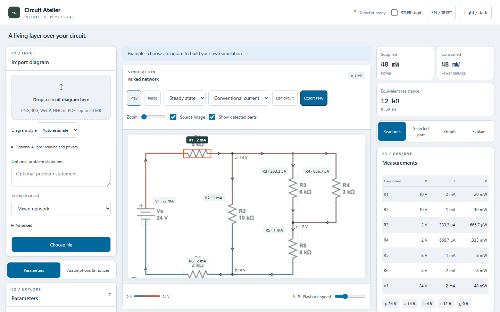

# Circuit Atelier

An experimental local Python/FastAPI and TypeScript circuit workspace with
editable English/Bangla simulation overlays. Recognition can be wrong: inspect
results and use Edit. See [status](docs/status.md) for measured limitations.

## Cross-platform setup

The detector and all four hybrid OCR model files now live inside `models/`.
Defaults use hybrid OCR and two CPU threads, matching the working local setup.
No paths into AugmentedPhysics or a user's EasyOCR cache are needed.

**For sharing one folder:** download the complete
[portable ZIP](https://github.com/THE-FOOL-T/circuit-sim/releases/download/portable-2026-11-11/circuit-sim-portable-2026-11-11.zip),
extract it, and share that folder or ZIP by pendrive. It includes real model bytes.
Each laptop needs Python **3.12**, Node **22+**, and internet for first setup.

On Windows, open PowerShell in the extracted folder and run:

```powershell
powershell -ExecutionPolicy Bypass -File .\setup.ps1
powershell -ExecutionPolicy Bypass -File .\run.ps1
```

Setup creates this laptop's environment, installs dependencies, and builds the
frontend. Do not copy `.venv` or `node_modules` between laptops.
See [sharing and troubleshooting](docs/portable_setup.md).

For Git users, install [Git LFS](https://git-lfs.com/) before cloning:

```sh
git lfs install
git clone https://github.com/THE-FOOL-T/circuit-sim.git any-folder-name
cd any-folder-name
git lfs pull
python -m venv .venv
```

Activate on Linux/macOS: `source .venv/bin/activate` (use `python3` if needed).
Activate in Windows PowerShell: `.\.venv\Scripts\Activate.ps1`.

```sh
python -m pip install -e .
python manage.py doctor
cd frontend
npm ci
npm run build
cd ..
python manage.py serve
```

Open <http://127.0.0.1:8000>. `python manage.py dev` starts Vite and the API.
CPU inference is supported. For CPU-only PyTorch, install the pinned Torch and
Torchvision versions from the PyTorch CPU wheel index before other requirements.
Install the complete requirements: OpenCV's full/headless versions are pinned
together because the detector and OCR dependencies request different packages
that share the same `cv2` namespace.

### Model files and configuration

The five required files are versioned with Git LFS. Their sizes and SHA-256
checksums are in [models/manifest.json](models/manifest.json).
`python manage.py doctor` detects missing, damaged, or unresolved LFS files.
For a ZIP download, use the complete release above: GitHub's ordinary
**Code > Download ZIP** may contain LFS pointers instead of models.

Defaults are in `config.example.yaml`. Copy to `config.local.yaml` for private,
gitignored overrides. Relative paths resolve from the repository root.
`CIRCUIT_MODEL`, `CIRCUIT_IMAGES`, and `CIRCUIT_EXTRA_IMAGES` override weights,
seen regression images, and the frozen reviewed reference respectively:

```sh
export CIRCUIT_MODEL=/path/to/last.pt
export CIRCUIT_IMAGES=/path/to/seen/images
export CIRCUIT_EXTRA_IMAGES=/path/to/reference99/images
```

In PowerShell use `$env:CIRCUIT_MODEL='C:\path\last.pt'` (likewise for images).
Datasets and detector weights are optional for unit tests. Private overrides from
an older installation can select different models or OCR; start with the bundled
defaults when comparing two laptops.

### Optional legacy OCR

The default hybrid OCR dependencies are installed by `pip install -e .`.
The included ONNX models and `bengali.pth` are sufficient for this path;
Tesseract, CRAFT, and the English EasyOCR model are not required.
Analysis never downloads models automatically.

To deliberately use `CIRCUIT_OCR_BACKEND=legacy`, install its separate engines:

Install Tesseract with English and Bengali language data. Ubuntu/Debian:
`sudo apt install tesseract-ocr tesseract-ocr-eng tesseract-ocr-ben`.
macOS/Homebrew: `brew install tesseract tesseract-lang`.
Windows: install Tesseract with eng/ben traineddata and add it to PATH, or set
`TESSERACT_CMD` to its executable path.

Alternatively explicitly download/cache EasyOCR models once:

```sh
python -c "import easyocr; easyocr.Reader(['en'],gpu=False); easyocr.Reader(['bn','en'],gpu=False)"
```

Analysis never downloads models. Unavailable OCR produces a warning; unread
values remain editable or explicitly assumed.

## UI tour

Choose or drop a diagram in the left upload card. Its preview and real analysis
stages appear there; the provenance banner distinguishes extracted, partial and
demonstration results. Canvas controls sit together above the diagram. Use
Parameters/Warnings and Readouts/Selected part/Graph/Explain tabs to inspect it, or Edit
for connection corrections. Explain shows supported reductions and updates when
values change. On a phone the panels share a bottom sheet. The
top bar switches language, digits and theme.



## Verification commands

RapidOCR + Bengali OCR is the portable default. Override it in
`config.local.yaml`, or with `CIRCUIT_OCR_BACKEND`.
The health endpoint reports `ocr_backend`, and startup warms the selected models. See
[hybrid OCR setup, measurements and rollback](docs/hybrid_ocr_integration.md).

```sh
python manage.py test       # backend/frontend tests, type check, build
python manage.py doctor     # verify all five bundled models
python manage.py check      # additionally focused Python lint
python manage.py browser    # server must already be running
python manage.py smoke      # needs CIRCUIT_IMAGES; regression, not accuracy
```

Install browser binaries explicitly: `cd frontend && npx playwright install
chromium`. Windows defaults to installed Edge. Set `CIRCUIT_BROWSER_CHANNEL`
to select another installed Playwright channel. Real-asset tests must skip when
optional assets are absent; unit tests use synthetic diagrams/analytical netlists.

## Privacy and licensing

Uploads stay in memory. Correction storage requires opt-in. Optional external
label reading is off by default and needs separate consent. The server-side
setup and crop limits are in [label reader](docs/label_reader.md). Never commit uploads,
datasets or credentials. The five manifest-listed inference models are the explicit
distribution exception; keep other training artifacts and local paths private.
Model notices and license texts are in [models/NOTICE.md](models/NOTICE.md).
Ultralytics licensing and data restrictions are also recorded in [decisions](docs/decisions.md).
No project-wide license grant is implied. Independent end-to-end accuracy stays
null without gold netlists; producing a simulation does not establish correctness.

See [verification](docs/verification.md) for measured tests, [performance](docs/performance.md)
for the 20-image CPU run, [detector results](docs/detector_results.md) for training
commands and promotion limits, and [manual QA](docs/manual-qa.md) for the owner
walkthrough. Linux/macOS commands are documented; execution was verified on Windows.


Round-three maintenance: `python manage.py check` enforces Ruff format/check
(100-column target) and Prettier before tests/build. To reformat, run
`python -m ruff format backend tools manage.py bootstrap.py`, then from frontend
`npx prettier --write src tests browser-tests playwright.config.ts vite.config.ts tsconfig.json package.json`.
Browser snapshots use platform-neutral filenames. With the local server running,
use `npx playwright test layout.spec.ts --update-snapshots` from frontend, inspect
every generated PNG and record findings in docs/ui-review.md before committing.
Linux/macOS should install Playwright Chromium (`npx playwright install chromium`);
Windows defaults to installed Edge. CIRCUIT_BROWSER_CHANNEL can override this.
Cross-platform execution remains unverified on this Windows host.
